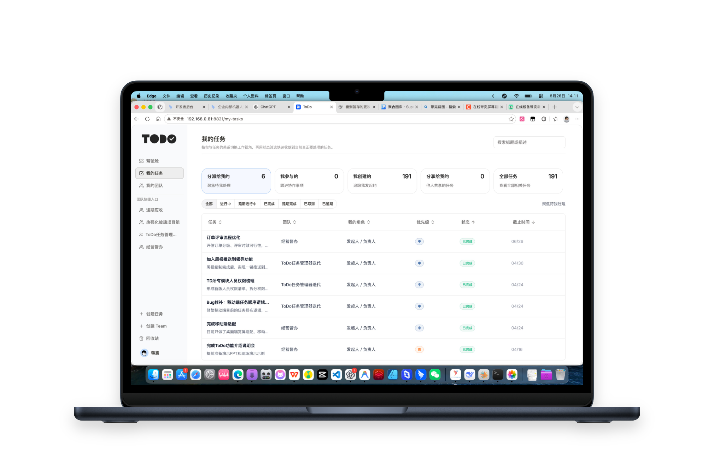
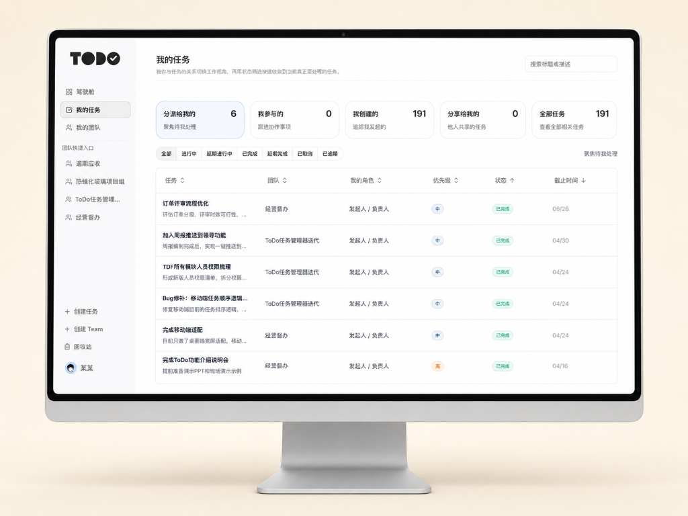
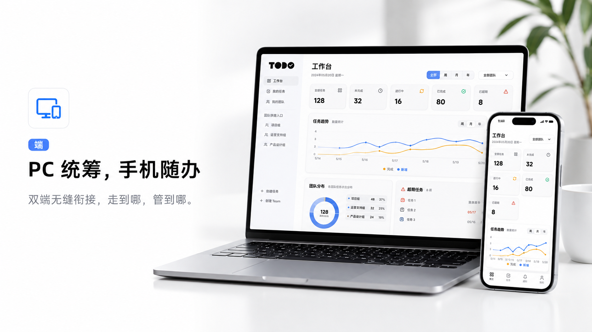

<p align="center">
  
</p>

<h3 align="center">ToDO 任务管理器</h3>

<p align="center">
  现代化的企业级任务协同、团队排期与钉钉深度集成平台。
</p>

<p align="center">
  <a href="LICENSE"></a>
  <a href="https://nodejs.org"></a>
  <a href="https://react.dev"></a>
  <a href="https://www.typescriptlang.org"></a>
  <a href="https://tailwindcss.com"></a>
</p>

---

<p align="center">
  
</p>

**ToDO**（ToDO 任务管理器）是一套专为团队日常协同与督办场景打造的高效任务管理系统。系统深度整合钉钉生态，提供直观的看板、排期甘特图、全员负荷驾驶舱与细粒度权限管控，帮助团队建立“件件有着落、事事有回音”的现代化数字协同文化。

---

## 核心特性展示

### 1. 任务全局看板与多维协同
提供多维视角管理团队任务，支持经典表格列表、看板拖拽流转、甘特排期与全景负荷驾驶舱无缝切换。

<p align="center">
  
</p>

### 2. 目标穿透与 WBS 任务细化拆解
支持主子任务递归关联、任务依赖与进度折叠展开，支持按责任人快速派发与跨部门多团队并行推进。

<p align="center">
  
</p>

### 3. 钉钉生态深度集成
专为钉钉工作台打造，提供原生级交互体验：
- **无缝免登**：支持钉钉移动端与 PC 端工作台一键免登进入。
- **扫码登录**：常规桌面浏览器支持直接扫码授权。
- **智能单聊通知**：基于钉钉机器人推送结构化卡片与沉浸式 ActionCard，重要通知一键穿透落地。
- **通讯录增量同步**：支持定时自动同步企业部门与员工通讯录。

<p align="center">
  
</p>

### 4. 全场景跨端自适应协同
针对桌面宽屏与移动设备进行深度视口适配，无论在办公室 PC 还是移动外出，随时随地推进闭环。

<p align="center">
  
</p>

---

## 办公生态适配与社区共创

ToDO 采用模块化解耦架构，认证（Auth）、组织同步（Sync）与消息推送（Notification/Robot）底层均已抽象为适配器（Adapter）模式。

| 办公生态 | 适配状态 | 核心能力 |
| :--- | :---: | :--- |
| **钉钉 (DingTalk)** | [已适配] **已深度适配** | 客户端免登、扫码登录、单聊机器人通知、ActionCard 落地页、通讯录定时同步 |
| **企业微信 (WeCom)** | [诚邀共创] **诚邀共创** | 企微自建应用免登、扫码登录、应用推送、通讯录同步（架构已预留，期待社区参与） |
| **飞书 (Feishu / Lark)** | [诚邀共创] **诚邀共创** | 飞书网页免登、扫码登录、互动卡片消息（Interactive Cards）、飞书组织架构同步 |

> [提示] **特别说明与共创倡议**：
> 本项目目前**优先完成了钉钉生态的完整适配与落地**，尚未支持企业微信和飞书。
> 我们非常渴望与社区开发者一起完善多平台协同生态！如果您对企业微信或飞书开发有经验，欢迎提交 [Issue](https://github.com/Jolly-J/ToDO/issues) 或发起 [Pull Request](https://github.com/Jolly-J/ToDO/pulls)，共同打造更加开放、好用的全平台任务管理器！

---

## 技术栈

### 前端 (Client)
- **核心框架**：React 19 + TypeScript 5.9 + Vite 8
- **样式与组件**：Tailwind CSS 4 + shadcn/Radix UI + Ant Design + Lucide Icons
- **状态管理**：Zustand
- **富文本能力**：TipTap 富文本编辑器

### 后端 (Server)
- **运行时框架**：Node.js + Express 5 (CommonJS)
- **数据持久化**：SQLite (`better-sqlite3`)
- **数据库迁移**：Knex
- **定时调度**：node-cron
- **外部集成**：钉钉开放平台 OpenAPI

---

## 快速上手（本地开发）

### 1. 环境准备
- Node.js >= 18.0.0
- npm >= 9.0.0

### 2. 获取代码与安装依赖

```bash
# 克隆代码库
git clone https://github.com/Jolly-J/ToDO.git
cd ToDO

# 安装依赖
npm install
npm --prefix client install
npm --prefix server install
```

### 3. 配置环境变量

复制前后端环境变量模板：

```bash
# 后端环境变量
cp server/.env.example server/.env

# 前端环境变量
cp client/.env.example client/.env
```

根据本地需求配置 `server/.env`（详见 `server/.env.example` 中的注释说明）：
- `JWT_SECRET`：设置随机密钥。
- `INITIAL_SUPER_ADMIN_IDS`：设置系统初始超级管理员的用户 ID（逗号分隔）。
- 钉钉相关配置（可选，如需联调钉钉接口按需填写）。

### 4. 启动开发服务

```bash
npm run dev
```

启动后：
- 前端开发界面：`http://localhost:8821`
- 后端 API 服务：`http://localhost:8344`

---

## 生产部署与钉钉配置

本项目提供了开箱即用的 PM2 进程守护配置，并针对**钉钉微应用与企业开放平台配置**编写了保姆级指南：

 **[查看完整生产部署与钉钉配置指南 (DEPLOY.md)](DEPLOY.md)**

该指南包含：
1. 生产环境单端口托管与构建打包全流程；
2. 钉钉企业内部应用创建与免登配置；
3. 钉钉单聊推送机器人（RobotCode）与消息卡片落地配置；
4. 钉钉通讯录权限申请与定时自动增量同步配置。

---

## 参与贡献 (Contributing)

我们非常欢迎任何形式的社区贡献！

1. **Fork** 本仓库并创建特性分支（`git checkout -b feature/wecom-adapter`）。
2. 提交您的修改，并保持代码整洁与注释清晰。
3. 确保前端类型检查通过：`npm --prefix client run typecheck`。
4. 发起 **Pull Request**，并在描述中说明改动原因和效果。

### 重点共创方向：
- [ ] 企业微信自建应用免登与应用消息适配
- [ ] 飞书网页免登与消息互动卡片适配
- [ ] 移动端 H5 / 小程序端轻量交互体验优化
- [ ] 跨平台日历订阅（iCal / CalDAV）

---

## 开源协议

本项目基于 [MIT License](LICENSE) 协议开源。
